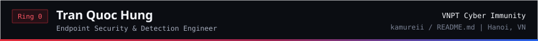
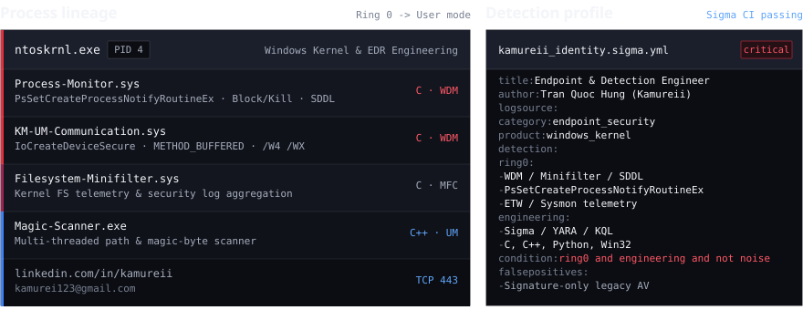
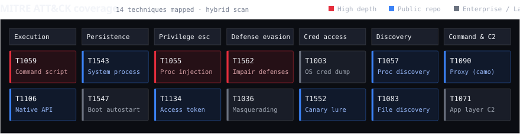
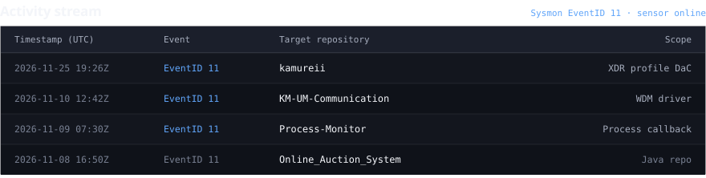

<!-- GENERATED BY generator/build_all.py — edit profile.config.yml or detections/kamureii_identity.sigma.yml -->

  

<picture>
  <source media="(prefers-color-scheme: dark)" srcset="https://kamureii-xdr-edge.kamureii.workers.dev/v1/alert.svg?theme=dark" />
  <source media="(prefers-color-scheme: light)" srcset="https://kamureii-xdr-edge.kamureii.workers.dev/v1/alert.svg?theme=light" />
  
</picture>

  &nbsp;&nbsp;

  

  

  

  

<code>Inspect raw Sigma identity rule, architecture &amp; direct links</code>

- **Sigma Bio Source:** [`detections/kamureii_identity.sigma.yml`](./detections/kamureii_identity.sigma.yml) (validated on every push via GitHub Actions)
- **Edge Telemetry Sensor:** [`worker/`](./worker) (Cloudflare Workers + D1 SQLite, zero PII stored — detects `github-camo` under `T1090`, Light Mode under `T1562`, and 60s burst cadence under `T1595`)
- **Featured Kernel / Security Repositories:**
  - [`Process-Monitor`](https://github.com/kamureii/Process-Monitor) — Windows WDM kernel driver (`PsSetCreateProcessNotifyRoutineEx`, `ZwTerminateProcess`, `STATUS_ACCESS_DENIED` blocking, `IoCreateDeviceSecure` SDDL)
  - [`KM-UM-Communication`](https://github.com/kamureii/KM-UM-Communication) — Hardened WDM driver & user-mode IOCTL client (`METHOD_BUFFERED`, `FILE_DEVICE_SECURE_OPEN`, `/W4 /WX` clean Code Analysis)
  - [`Multi-Threading-Magic-Scanner`](https://github.com/kamureii/Multi-Threading-Magic-Scanner) — C++ multi-threaded file path & magic-byte scanner
- **Contact:** [LinkedIn](https://www.linkedin.com/in/kamureii/) · [`kamurei123@gmail.com`](mailto:kamurei123@gmail.com)

